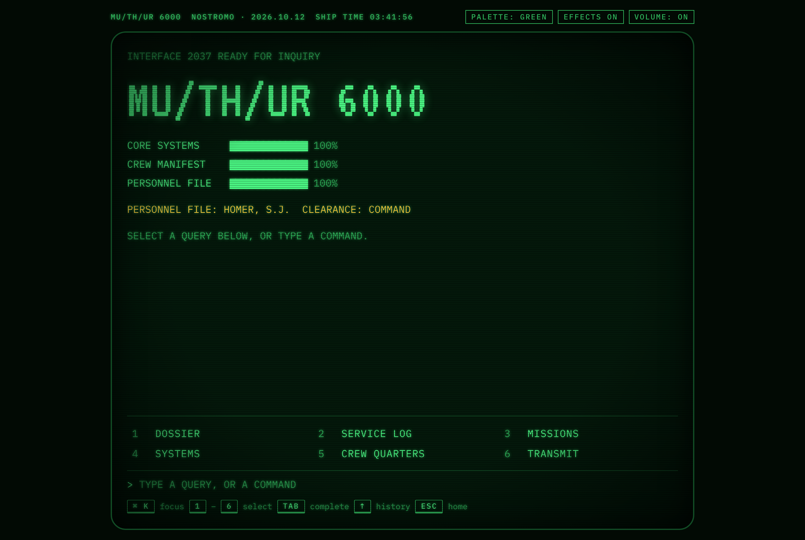
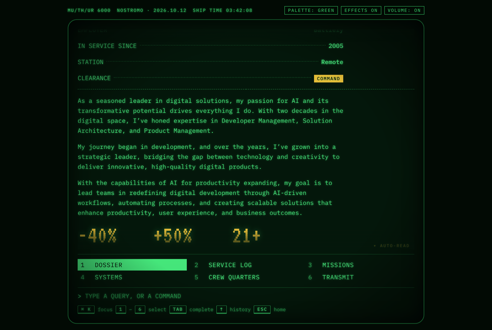
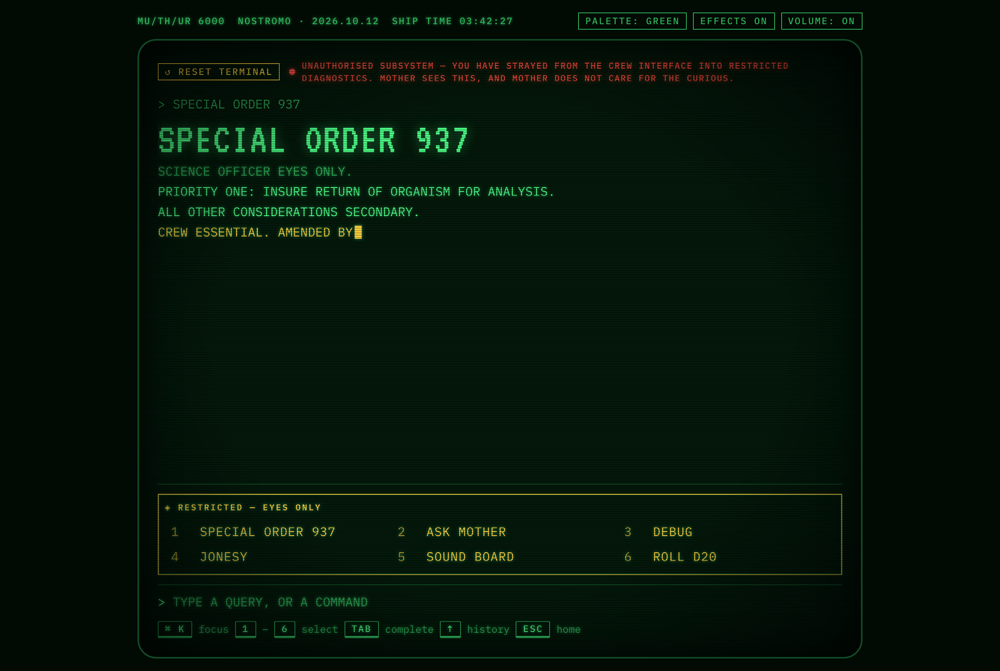

# dev.sjhomer.com — a career you boot like the Nostromo

> **PERSONNEL FILE: HOMER, S.J. — CLEARANCE: COMMAND**

[dev.sjhomer.com](https://dev.sjhomer.com) is a developer portfolio in the shape
of the **MU/TH/UR 6000**, the ship's computer from _Alien_. You don't scroll a
résumé — you boot the mainframe, query the crew file, and the answers type back
at you line by line in cold green phosphor. The terminal _is_ the navigation,
not a chrome wrapped around a normal site.

This is a case study of how it came to be: a love of science fiction, one
written plan, and a long run of iteration to get from that plan to something
alive.

## The spark

I grew up on science fiction, and nothing in it has aged better than the
_computers_. The _Alien_ franchise in particular treated its interfaces as
characters: the chunky readouts, the unhurried cursors, MOTHER answering in
clipped capitals while the Nostromo's crew argued around her. Those screens are
some of the most atmospheric machines ever put on film, precisely because they
are slow, deliberate, and a little ominous.

I wanted to build one — and to use it to talk about two decades of engineering
work without reaching for yet another card grid. So before a line of product
code existed, there was a document: a **solution plan** that imagined the whole
thing as a terminal session. _The visitor plays a Nostromo crew member at the
interface-room console. They boot the ship's computer and interrogate it for
crew file `SJHOMER`._ That one framing decided everything that followed.

The plan set four pillars, and they turned out to be load-bearing:

- **Diegetic, not decorative.** Every section is a query and a response, so the
  theme _is_ the navigation rather than a skin over an ordinary page.
- **Readable in ten seconds.** A recruiter who never types still gets a numbered
  menu and a way to print the whole crew file instantly. Typing is a delight,
  never a requirement.
- **Content separate from presentation.** The career lives in typed data files;
  the terminal only renders them. One source also becomes a plain `/cv`, the
  JSON-LD, and a generated PDF — so nothing can drift out of sync.
- **Restraint in the effects.** Green-on-black phosphor, scanlines and a slight
  bloom, all tuned _low_, because people actually have to read this.

## The idea that held: a computer you interrogate

The site answers to the same instincts a real terminal does. Three input modes
run side by side: a **command line**, **numbered options** you can click or key,
and ordinary **links** for screen readers and crawlers. Query it and the answers
come back in MOTHER's voice; the career becomes a thing you _interrogate_ rather
than a page you consume.

Everything is framed in the fiction. The CV is a **service log**. Case studies
are **missions**. Skills are **systems**. Life off-duty is the **crew quarters**.
Contact is a **transmission channel**. The dossier opens with the professional
pitch rendered as MOTHER's own summary of the officer — and the service record
runs _2005 → present_, the year the career (and, not by accident, the ship's own
countdown numbering) began.

_Querying the crew file — every answer types back line by line, with a
reading-paced auto-scroll._

## What survived, and what changed

The honest part of any build is the distance between the plan and the thing that
ships. Much of the plan survived intact — the pillars, the content model, the
three input modes, the phosphor palette, the progressive-enhancement spine. But
the character of the site came from the places it _changed_, through iteration
and a fair amount of stubbornness:

- **The planned LLM was dropped before launch.** The plan held room for an
  optional "Ask MOTHER" feature backed by a live model; it never shipped. A
  terminal that hallucinates its own crew's history is a worse terminal, and the
  site is sharper for staying grounded in the typed content.
- **The engine was hand-rolled.** No `xterm.js` — that's built for real shells.
  A small set of React primitives type content out character by character while
  the _full_ text already sits in the DOM, so every word stays selectable,
  copyable, indexable, and readable without the animation ever running.
- **The whole experience shipped at once.** The plan proposed a tidy four-phase
  roadmap. In practice the terminal, atmosphere, audio and easter eggs wanted to
  be built together — they only make sense as one piece — so the first release
  was the _whole_ MU/TH/UR, verified end to end and merged in one consolidated
  go-live, with the domain cut over from the old site earlier than planned.
- **The best parts weren't in the plan at all.** The analog **control knobs**
  in the header, and the full **design manual** at `/guide`, were post-launch
  additions — the kind of thing you only think to build once the machine is
  running and you start treating it like an instrument.

Nothing here was generated once and shipped. It was tuned — the cadence of the
typing, the exact green, the weight of the bloom, the way a line _holds_ before
it morphs — until it felt like the screens I remembered.

## Building it, line by line

Under the theatre, the craft is ordinary and deliberate:

- **One typed, Zod-validated content model** feeds the terminal, the printable
  `/cv`, the structured data and the generated PDF. Adding the next role is a
  one-file change, and the four Battlefy years missing from the legacy site
  arrived simply by adding their entries.
- **Progressive enhancement, genuinely.** Each route server-renders its full
  text with its own title, description and Open Graph image; the terminal then
  takes over the same page and replays it with the typing effect. Turn off
  JavaScript and you still get the entire crew file.
- **Atmosphere you can switch off.** The CRT layer — scanlines, a soft
  `text-shadow` bloom, a flicker under three percent, a vignette — is all CSS,
  and `prefers-reduced-motion` (or a visible toggle) collapses it to instant,
  calm text. Three palettes share one set of tokens: **mother** green,
  **sevastopol** amber, and a paper-white **hardcopy** for print.
- **Original sound, off by default.** Every effect — the boot drone, the key
  clicks, the danger klaxon, the self-destruct tick that rises in pitch — is
  synthesised with the Web Audio API. No sampled or copyrighted film audio is
  used anywhere. A one-time gate asks before anything ever plays.

It rides on TanStack Start (React 19) at the edge on Cloudflare Workers, gated
by unit and end-to-end tests, and it was built to a budget: full text and
function with the animation turned off, and the heavy flourishes loaded only
when a device can afford them.

## The easter eggs

Half the fun is what's _not_ on the menu — cheap to add once the command
registry exists, and impossible to resist:

| Command                   | What happens                                                                                                                                                               |
| ------------------------- | -------------------------------------------------------------------------------------------------------------------------------------------------------------------------- |
| `SPECIAL ORDER 937`       | The infamous directive prints — _"ensure return of organism… crew expendable"_ — then the cursor hangs, and the last line is amended, on screen, to **CREW ESSENTIAL**.    |
| `WHAT'S THE STORY MOTHER` | Arms the **emergency destruct sequence**: a full-screen countdown with a tick that climbs in pitch. An escalating **Abort** control stands it down — or let it reach zero. |
| `ROLL D20`                | Rolls the dice, a nod to a lifelong love of tabletop RPGs. A natural 1 trips the **danger klaxon**; a natural 20 sounds the **all-clear**.                                 |
| `JONESY`                  | The ship's cat is accounted for.                                                                                                                                           |
| `DEBUG`                   | A tongue-in-cheek self-diagnostic that reads real live values — viewport, palette, uptime — and wraps them in Nostromo flavour.                                            |
| `SOUND BOARD`             | A playable board of every sound effect, revealed one pad at a time.                                                                                                        |
| `↑ ↑ ↓ ↓ …`               | The Konami code flips the palette to **Sevastopol** amber: _"PALETTE OVERRIDE ACCEPTED. WELCOME TO SEVASTOPOL STATION."_                                                   |

## Colophon

A personal project, and a love letter. Fonts **VT323** and **IBM Plex Mono**
under the SIL Open Font License. _Alien_, the Nostromo, MU/TH/UR and Sevastopol
Station are the creations of their respective rights holders; this is an
unaffiliated fan tribute and personal portfolio, and every sound in it is
original.

— built by [S.J. Homer](https://dev.sjhomer.com). Query `TRANSMIT` to open a channel.
